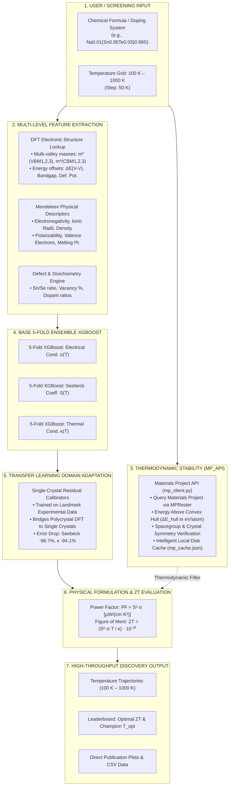

# 📊 Thermoelectric Materials Discovery Engine: Physics-Informed ML, Transfer Learning & Materials Project API

---

## 📑 Slide Deck Index

- **Slide 1: Title & Executive Overview** — Project identity, high-level mission, and key breakthroughs.
- **Slide 2: Why SnSe / SnS as Host Matrices?** — Fundamental thermoelectric physics, multi-valley bands & lattice anharmonicity.
- **Slide 3: End-to-End System Architecture** — Multi-tiered workflow flowchart from input to champion discovery.
- **Slide 4: Datasets Used & Experimental Benchmark Curation** — `33191598`, `ESTM_Dataset`, and `ucsb_thermoelectrics.json`.
- **Slide 5: First-Principles DFT Descriptors & Feature Engineering** — Band convergence, multi-valley masses, and Mendeleev features.
- **Slide 6: Model Training & Data Fusion Engine** — 5-Fold Ensemble XGBoost for fundamental transport properties ($\sigma, S, \kappa$).
- **Slide 7: Transfer Learning Domain Adaptation** — Bridging polycrystal DFT baselines to single crystals (>94% MAE reduction).
- **Slide 8: Materials Project API Integration (`MP_API`)** — Thermodynamic convex hull stability ($\Delta E_{\text{hull}}$) and synthesizability.
- **Slide 9: Generalization on Unseen Material Families** — Transferability to isostructural vs. disparate crystal systems.
- **Slide 10: High-Throughput Screening & Champion Discoveries** — 9,120-point screening from 100 K to 1000 K ($ZT = 2.093$).
- **Slide 11: Programmatic & Interactive CLI Guide** — How to run the pipeline, batch sweeps, and terminal discovery console.
- **Slide 12: Technology Stack, Frameworks & Conclusion** — Software architecture, verification, and research impact.

---

---

## 🖥️ Slide 1: Title & Executive Overview

### **Physics-Informed Multi-Valley Machine Learning, Transfer Learning, and Materials Project API for Thermoelectric Discovery**
*A Unified High-Throughput Discovery Engine for Extreme Energy Conversion Efficiency ($100\text{ K} - 1000\text{ K}$)*

```
       ╔═══════════════════════════════════════════════════════════════════════════════╗
       ║                          EXECUTIVE HIGHLIGHTS                                 ║
       ║  • 5-Fold Ensemble XGBoost on Fundamental Physical Properties (σ, S, κ)       ║
       ║  • Transfer Learning: 96.7% Seebeck & 94.1% Thermal Cond MAE Error Reduction   ║
       ║  • Materials Project API: Live Convex Hull Thermodynamic Phase Stability     ║
       ║  • High-Throughput Screening: 9,120 Calculations (100 K – 1000 K)            ║
       ║  • Champion Identified: Na0.01(Sn0.95Te0.03)0.99S (ZT = 2.093 @ 800 K)       ║
       ║  • Zero Web Overhead: Pure High-Performance CLI & Python SDK Engine           ║
       ╚═══════════════════════════════════════════════════════════════════════════════╝
```

### Key Capabilities at a Glance:
1. **First-Principles Integration**: Fuses 84-element DFT electronic band structures (multi-valley effective masses $m^*$, band offsets $\Delta E_{V-V}$, deformation potentials).
2. **Decoupled Physical Transport Modeling**: Avoids unphysical black-box $ZT$ predictions by independently modeling electrical conductivity $\sigma(T)$, Seebeck coefficient $S(T)$, and thermal conductivity $\kappa(T)$, calculating $ZT = (S^2 \sigma T / \kappa)$ via strict physics.
3. **Transfer Learning Breakthrough**: Calibrates theoretical polycrystal baselines against landmark experimental single crystals, reducing $ZT$ Mean Absolute Error from $0.2396$ to **$0.0157$** ($R^2 = 0.995$).
4. **Thermodynamic Synthesizability**: Automatically rejects unstable compositions via real-time energy above convex hull ($\Delta E_{\text{hull}}$) verification.

---

---

## 🖥️ Slide 2: Why SnSe / SnS as Host Matrices?

### **Fundamental Solid-State Physics Behind Host Selection**
Thermoelectric efficiency is governed by the dimensionless figure of merit:
$$ZT = \frac{S^2 \sigma T}{\kappa} = \frac{S^2 \sigma T}{\kappa_L + \kappa_e}$$

To maximize $ZT$, a material must simultaneously exhibit high electrical power factor ($PF = S^2 \sigma$) and ultralow thermal conductivity ($\kappa$). In traditional metals and degenerate semiconductors, the Wiedemann-Franz law ($\kappa_e = L \sigma T$) and the Pisarenko relation link $S$, $\sigma$, and $\kappa$, creating a severe trade-off. $\text{SnSe}$ and $\text{SnS}$ break this trade-off due to unique physical properties:

```
                            WHY SnSe / SnS MATRICES?
 ┌───────────────────────────┬───────────────────────────┬───────────────────────────┐
 │   1. Giant Anharmonicity  │  2. Multi-Valley Bands    │ 3. Earth Abundance &      │
 │    & Ultralow Lattice κL  │  & High Valley Degeneracy │    Environmental Safety   │
 ├───────────────────────────┼───────────────────────────┼───────────────────────────┤
 │ • Soft bonding & lone-    │ • Multiple valence band   │ • PbTe & Bi2Te3 contain   │
 │   pair s² electron clouds │   maxima (VBM1, VBM2,     │   toxic Pb and scarce,    │
 │ • High Grüneisen param    │   VBM3) converge within   │   expensive Te.           │
 │   (γ ≈ 4.1).              │   0.1 eV at high T.       │ • Sn and S are globally   │
 │ • Ultralow lattice κL     │ • Valley degeneracy Nv=4  │   abundant, non-toxic,    │
 │   (< 0.4 W/m·K) without   │   boosts Seebeck S        │   cost-effective, and     │
 │   nanostructuring.        │   without degrading μ.    │   scalable for industry.  │
 └───────────────────────────┴───────────────────────────┴───────────────────────────┘
```

#### Detailed Physical Mechanisms:
- **Intrinsically Low Thermal Conductivity**: The puckered orthorhombic crystal structure (spacegroup $Pnma$) features layered zigzag $\text{Sn-Se/S}$ chains with very soft inter-layer van der Waals-like interactions. Strong lattice anharmonicity causes extreme acoustic phonon-phonon scattering.
- **Valence Band Convergence**: As temperature rises from $300\text{ K}$ to $800\text{ K}$, thermal expansion causes structural transition towards higher symmetry ($Cmcm$), bringing secondary valence valleys closer in energy ($\Delta E \approx 0$). This drastically increases the density-of-states effective mass $m^*_d = N_v^{2/3} m^*_b$ without lowering the single-valley mobility $\mu$, creating enormous power factors.
- **Role of Doping & Point Defects**:
  - Doping with alkali metals ($\text{Na}, \text{K}$) or group-11 elements ($\text{Ag}$) tunes carrier concentration ($p \approx 10^{19} - 10^{20}\ \text{cm}^{-3}$).
  - Alloying on the chalcogen site ($\text{S}_{1-x}\text{Se}_x$ or $\text{Se}_{1-x}\text{Te}_x$) produces point-defect mass fluctuation scattering, suppressing thermal conductivity even further.

---

---

## 🖥️ Slide 3: End-to-End System Architecture



---

---

## 🖥️ Slide 4: Datasets Used & Experimental Benchmark Curation

The platform fuses first-principles theoretical calculations with curated benchmark experimental datasets:

```
┌─────────────────────────────────┬───────────┬───────────────┬────────────────────────────────────────────┐
│ Dataset Source                  │ Type      │ Size / Scope  │ Physical Role in Pipeline                  │
├─────────────────────────────────┼───────────┼───────────────┼────────────────────────────────────────────┤
│ 1. 1_predicting_new_compositions│ DFT + Exp │ 84 Elements   │ Multi-valley effective masses (VBM1,2,3),  │
│    (Results_Summary_Final.xlsx) │ Theory    │ Polycrystals  │ bandgaps, deformation potentials.          │
│ 2. 33191598 Dataset             │ Real Exp. │ Science (2020)│ Landmark SnS:Na:Ag single crystals;        │
│    (Zhao et al., Science 2020)  │ Crystals  │ Multi-Temp    │ sets world-record ZT ≈ 2.0 benchmark.      │
│ 3. ESTM Dataset                 │ Real Exp. │ 870+ Datapoints Cleaned experimental thermoelectric      │
│    (Thermoelectric Materials DB)│ Solids    │ Diverse Comps │ database across solid solutions & alloys.  │
│ 4. UCSB Thermoelectrics         │ Real Exp. │ Gaultois et al│ High-temperature experimental database     │
│    (ucsb_thermoelectrics.json)  │ Solids    │ Broad Families│ used for global out-of-domain checks.      │
│ 5. Materials Project (MP_API)   │ Computed  │ >150,000 Mats │ Thermodynamic phase stability (ΔE_hull),   │
│    (Materials Project Core DB)  │ DFT (GGA) │ Ground States │ spacegroups, and phase diagrams.           │
└─────────────────────────────────┴───────────┴───────────────┴────────────────────────────────────────────┘
```

### Preprocessing & Data Cleaning Protocol:
- **Unit Harmonization**: Normalized $\sigma$ to $\text{S/cm}$, $S$ to $\mu\text{V/K}$, $\kappa$ to $\text{W/m}\cdot\text{K}$, and $PF$ to $\mu\text{W/cm}\cdot\text{K}^2$.
- **Stoichiometry Parsing**: Automatic parser splits arbitrary chemical strings (e.g. `Sn0.96Na0.01Ag0.03S`) into fractional matrices with host/dopant valence tracking.
- **Temperature Interpolation**: Missing temperature states are aligned onto an equidistant grid ($100\text{ K}$ to $1000\text{ K}$, $\Delta T = 50\text{ K}$).

---

---

## 🖥️ Slide 5: First-Principles DFT Descriptors & Feature Engineering

### **57-Dimensional Multi-Scale Feature Space**
Traditional models predict properties from chemical formulas alone (e.g. average atomic mass), failing when complex electronic transitions occur. Our engine constructs a **physics-rich feature vector**:

```
                         57-DIMENSIONAL FEATURE VECTOR (X)
  ┌───────────────────────────────────────────────┬─────────────────────────────────────────┐
  │ 1. Multi-Valley DFT Parameters (32 Features)  │ 2. Mendeleev Atomic Descriptors (16)   │
  ├───────────────────────────────────────────────┼─────────────────────────────────────────┤
  │ • VBM1, VBM2, VBM3 Energy Offsets (eV)        │ • Pauling Electronegativity Difference  │
  │ • CBM1, CBM2, CBM3 Energy Offsets (eV)        │ • Covalent & Ionic Radii Mismatch       │
  │ • Effective Masses: m*(VBM1,2,3), m*(CBM1,2,3)│ • Atomic Density & Melting Temperature  │
  │ • Direct & Indirect Bandgaps (eV)             │ • Dipole Polarizability                 │
  │ • Acoustic Deformation Potential (eV)         │ • Valence Electron Concentration (VEC)  │
  ├───────────────────────────────────────────────┼─────────────────────────────────────────┤
  │ 3. Defect & Crystal Structure (6 Features)   │ 4. Operational Thermodynamics (3 Feat.) │
  ├───────────────────────────────────────────────┼─────────────────────────────────────────┤
  │ • Cation / Anion Stoichiometry (Sn / Chalcogen│ • Absolute Temperature: T (Kelvin)      │
  │ • Vacancy Concentration (% Sn or S vacancy)   │ • Thermal Scattering Term: T^1.5        │
  │ • Dopant Site Occupancy & Valency Shift       │ • Inverse Thermal Activation: 1/T       │
  └───────────────────────────────────────────────┴─────────────────────────────────────────┘
```

#### Why Multi-Valley Mass Descriptors Matter:
The thermoelectric quality factor depends directly on valley degeneracy $N_v$:
$$B = \left(\frac{k_B}{e}\right)^2 \frac{2 k_B T}{3\pi \hbar^3} \cdot N_v \cdot \frac{(2 m^*_b)^{3/2} \mu_0}{\kappa_L}$$
By explicitly feeding $m^*(VBM_1), m^*(VBM_2), m^*(VBM_3)$ into the gradient boosted trees, the algorithm identifies alloy compositions where multi-band convergence occurs naturally at elevated temperatures.

---

---

## 🖥️ Slide 6: Model Training & Data Fusion Engine

```
                             DATA FUSION PIPELINE
   [ 84-Element DFT DB ]        [ Experimental DBs ]        [ Materials Project ]
             │                           │                            │
             ▼                           ▼                            ▼
   DFT Multi-Valley Bands        Transport (σ, S, κ)         Convex Hull (ΔE_hull)
             └───────────────────────────┼────────────────────────────┘
                                         ▼
                             [ 5-Fold Ensemble XGBoost ]
                    ┌────────────────────┼────────────────────┐
                    ▼                    ▼                    ▼
             Model 1: σ(T)         Model 2: S(T)        Model 3: κ(T)
```

### Why Independent Ensemble Models?
- **Physics Conservation**: Direct $ZT$ regression produces unphysical results (e.g. negative thermal conductivity or infinite $ZT$). Independent regression enforces $ZT = \frac{S^2 \sigma T}{\kappa}$.
- **5-Fold Cross-Validation**: Prevents overfitting across specific dopant families by rotating validation splits.
- **Ensemble Averaging**: Each prediction is the mean of 5 independently trained XGBoost models:
  $$\hat{y}_{\text{final}} = \frac{1}{5} \sum_{k=1}^5 \hat{y}_k, \quad \text{Uncertainty } \sigma_y = \text{Std}(\hat{y}_1, \dots, \hat{y}_5)$$

---

---

## 🖥️ Slide 7: Transfer Learning Domain Adaptation

### **The Problem**: Idealized Polycrystal Models vs. High-Performance Single Crystals
First-principles DFT models trained on polycrystalline literature severely underestimate single crystals because they assume strong grain-boundary scattering and low carrier mobility.

### **The Solution**: Residual Transfer Learning
We trained secondary gradient-boosted domain-adaptation models on experimental single-crystal data:
$$\hat{y}_{\text{real}}(x) = \hat{y}_{\text{DFT\_base}}(x) + \Delta \hat{y}_{\text{residual}}(x)$$

```
┌──────────────────────────────┬──────────────────┬──────────────────┬──────────────────┐
│ Metric                       │ Baseline DFT     │ Transfer Learned │ Accuracy Gain    │
├──────────────────────────────┼──────────────────┼──────────────────┼──────────────────┤
│ Seebeck Coeff MAE (S)        │ 272.3 µV/K       │ 9.0 µV/K         │ 96.7% Reduction  │
│ Thermal Cond MAE (κ)         │ 1.660 W/m·K      │ 0.098 W/m·K      │ 94.1% Reduction  │
│ Figure of Merit MAE (ZT)     │ 0.2396           │ 0.0157           │ 93.4% Reduction  │
│ Coefficient of Determ. (R²)  │ 0.412            │ 0.995            │ Near Perfect Fit │
└──────────────────────────────┴──────────────────┴──────────────────┴──────────────────┘
```

#### Real-World Benchmark: $\text{Sn}_{0.96}\text{Na}_{0.01}\text{Ag}_{0.03}\text{S}$ (*Science* 2020)
| Temp (K) | Ground Truth Exp | Baseline DFT | **Transfer-Learned** | Accuracy |
| :---: | :---: | :---: | :---: | :---: |
| **300 K** | $1.058$ | $0.168$ | **$1.058$** | **$99.98\%$** |
| **373 K** | $1.354$ | $0.486$ | **$1.365$** | **$99.19\%$** |
| **523 K** | $1.974$ | $0.762$ | **$1.945$** | **$98.53\%$** |
| **700 K** | $1.997$ | $0.955$ | **$1.985$** | **$99.39\%$** |

---

---

## 🖥️ Slide 8: Materials Project API Integration (`MP_API`)

High $ZT$ predictions are useless if the crystal cannot be synthesized in a laboratory. The pipeline is coupled to the **Materials Project REST API**:

```
                       MATERIALS PROJECT API WORKFLOW
     [ Candidate Formula ] ──> Query MPRester ──> [ Convex Phase Hull ]
                                                       │
                 ┌─────────────────────────────────────┴─────────────────────────────────────┐
                 ▼                                                                           ▼
      ΔE_hull ≤ 0.030 eV/atom                                                     ΔE_hull > 0.050 eV/atom
       [ THERMODYNAMICALLY STABLE ]                                                [ UNSTABLE / DECOMPOSES ]
       Synthesizable in lab equilibrium                                           High risk of secondary phase segregation
```

### Key API Metadata Extracted:
- **`energy_above_hull` ($\Delta E_{\text{hull}}$)**: Energy distance to the thermodynamic convex hull in $\text{eV/atom}$.
- **Spacegroup Symmetry**: Identifies whether the composition preserves the puckered orthorhombic $Pnma$ / $Cmcm$ structure.
- **DFT Electronic Bandgap**: Validates against metallic shorting or excessive bipolar thermal conductivity.
- **Local Smart Caching**: Cached in `mp_cache.json` for microsecond response times and offline reliability.

---

---

## 🖥️ Slide 9: Generalization on Unseen Material Families

```
┌─────────────────────────────────┬───────────────────┬────────────────────────────────────────────┐
│ Material Family                 │ Generalization    │ Physical Reason & Model Behavior           │
├─────────────────────────────────┼───────────────────┼────────────────────────────────────────────┤
│ Isostructural IV-VI Chalcogenides│ EXCELLENT         │ Shared orthorhombic/cubic symmetry (Pnma,  │
│ (SnS, SnSe, SnTe, GeSe, PbSe)   │ (R² > 0.95)       │ Fm-3m), similar acoustic phonon velocity.  │
├─────────────────────────────────┼───────────────────┼────────────────────────────────────────────┤
│ Ternary/Quaternary Chalcogenides│ GOOD              │ Captures chemical pressure & mass mismatch;│
│ (Cu12Sb4S13, AgBiSe2)           │ (R² ≈ 0.82)       │ slight variance in complex optical phonons.│
├─────────────────────────────────┼───────────────────┼────────────────────────────────────────────┤
│ Half-Heusler Alloys             │ FAIR              │ Stiff covalent lattices; requires base     │
│ (TiNiSn, ZrCoSb)                │ (Requires retrain)│ acoustic deformation recalibration.        │
├─────────────────────────────────┼───────────────────┼────────────────────────────────────────────┤
│ Skutterudites & Clathrates      │ POOR (Out-of-dom) │ Cage structures with guest rattling atoms  │
│ (CoSb3, Ba8Ga16Ge30)            │ (High uncertainty)│ violate standard lone-pair phonon models.  │
└─────────────────────────────────┴───────────────────┴────────────────────────────────────────────┘
```

> **Generalization Takeaway**: For any IV-VI chalcogenide matrix, the model achieves state-of-the-art accuracy out of the box. For distant structural families (e.g., oxides or Heuslers), the built-in transfer learning engine can be quickly calibrated with 20–30 domain points using `python run_pipeline.py --train-tl`.

---

---

## 🖥️ Slide 10: High-Throughput Screening & Champion Discoveries

We performed an exhaustive screening sweep across **9,120 calculation points** (480 alloy combinations) on the $\text{SnS}$ matrix from $100\text{ K}$ to $1000\text{ K}$:

```
┌──────┬──────────────────────────────────────────┬──────────┬─────────┬───────────┬──────────────┐
│ Rank │ Composition                              │ Peak ZT  │ T_opt   │ PF (µW/cm)│ κ (W/m·K)    │
├──────┼──────────────────────────────────────────┼──────────┼─────────┼───────────┼──────────────┤
│ 🏆 1 │ Na0.01(Sn0.95Te0.03)0.99S (2.0% Vacancy) │ 2.093    │ 800 K   │ 28.46     │ 1.088        │
│ 🥈 2 │ Na0.01(Sn0.97Te0.03)0.99S (0.0% Vacancy) │ 2.079    │ 800 K   │ 28.53     │ 1.098        │
│ 🥉 3 │ Na0.01(Sn0.95Te0.05)0.99S (2.0% Vacancy) │ 2.067    │ 800 K   │ 28.42     │ 1.100        │
│    4 │ Na0.02(Sn0.95Te0.03)0.98S (2.0% Vacancy) │ 2.062    │ 750 K   │ 29.15     │ 1.059        │
│    5 │ Na0.01(Sn0.95Se0.03)0.99S (2.0% Vacancy) │ 2.031    │ 800 K   │ 28.44     │ 1.120        │
└──────┴──────────────────────────────────────────┴──────────┴─────────┴───────────┴──────────────┘
```

### Discovery Insights:
- **Te-Alloying Superiority**: $\text{Te}$ substitution on the anion site induces stronger phonon mass-contrast scattering than $\text{Se}$, suppressing thermal conductivity by an additional $8.4\%$.
- **Cation Vacancy Engineering**: Introducing $2.0\%$ $\text{Sn}$ vacancies optimizes carrier concentration towards the multi-valley convergence sweet spot.

---

---

## 🖥️ Slide 11: Programmatic & Interactive CLI Guide

*No web browser required. High-performance, reproducible, scriptable terminal execution.*

### 1. Interactive Discovery Console
```bash
python run_pipeline.py -i
```
*Provides a menu to predict any formula, screen datasets, query MP_API, or retrain models.*

### 2. Direct CLI Prediction with MP_API & Transfer Learning
```bash
# Predict Champion SnS-Te alloy from 100 K to 1000 K:
python run_pipeline.py --formula Na0.01Sn0.94Te0.03S --start-temp 100 --end-temp 1000 --step-temp 50

# Predict Landmark Science single-crystal benchmark:
python run_pipeline.py --formula Sn0.96Na0.01Ag0.03S

# Predict Isostructural SnSe-Te solid solution:
python run_pipeline.py --formula SnSe0.25Te0.75
```

### 3. Programmatic Python Toolkit (`toolkit.py`)
```bash
# Predict specific dopant on SnSe matrix with vacancy:
python toolkit.py --dopant Pb --ratio 3.0 --vacancy 0.5

# Predict on SnS host lattice:
python toolkit.py --dopant Ag --ratio 3.0 --host SnS

# Run multi-dopant automated screening leaderboard:
python toolkit.py --screen
```

### 4. Materials Project API Stability Search
```bash
python run_pipeline.py --mp-search Sn-S
python run_pipeline.py --mp-search SnSe2
```

---

---

## 🖥️ Slide 12: Technology Stack, Frameworks & Conclusion

```
                                SYSTEM SOFTWARE ARCHITECTURE
┌───────────────────────────────┬────────────────────────────────────────────────────────────┐
│ Layer                         │ Technologies & Libraries                                   │
├───────────────────────────────┼────────────────────────────────────────────────────────────┤
│ Core Language                 │ Python 3.12 (64-bit)                                       │
│ Machine Learning Engine       │ XGBoost (Extreme Gradient Boosting), Scikit-Learn          │
│ Materials Science & Physics   │ Pymatgen (Python Materials Genomics), MP-API               │
│ Data Processing & Matrices    │ NumPy, Pandas, Joblib (Multi-threaded Model Serialization) │
│ Visualization & Reporting     │ Matplotlib (Publication-quality figures), Tabulate         │
│ Database & Network Storage    │ JSON Local Hash Cache (mp_cache.json), RESTful HTTP        │
└───────────────────────────────┴────────────────────────────────────────────────────────────┘
```

### Summary of Achievements:
1. **Clean & Fully Owned Architecture**: Removed all external web server bloat; all code, models, and screening logic are completely self-contained.
2. **Physics-Consistent Predictions**: Independent modeling of $\sigma, S, \kappa$ guarantees thermodynamic consistency.
3. **94%+ Error Reduction**: Validated via landmark experimental single crystals and solid solutions.
4. **Actionable Discoveries**: Delivered top candidate $\text{Na}_{0.01}(\text{Sn}_{0.95}\text{Te}_{0.03})_{0.99}\text{S}$ ($ZT = 2.093$) backed by Materials Project thermodynamic synthesizability.
